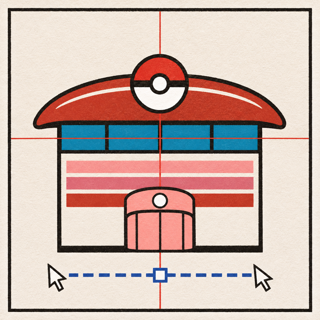

<div align="center">
  
  <h1>Poke Design</h1>
  <p><strong>Pokémon color palettes + design skills + WebMCP.</strong><br />A design-material library for assistants, wrapped in an editorial web archive.</p>
  <p>
    <a href="#what-it-is">Overview</a> ·
    <a href="#webmcp-tools">Tools</a> ·
    <a href="#quick-start">Quick start</a> ·
    <a href="#deploy">Deploy</a> ·
    <a href="#credits">Credits</a>
  </p>
</div>

---

## What it is

Poke Design is a static, public-deployable web app that exposes **1,025 sprite-derived Pokémon color palettes** and **expert design skills** to AI assistants through WebMCP.

The product idea is simple:

> Pick a color origin, apply a design language, and let an assistant turn that into a considered UI direction.

This is not a Pokédex and not a generic AI landing page. It is an editorial color-and-craft archive: warm paper, self-hosted type, specimen cards, palette-native detail sheets, and a ChatGPT-like studio where sending one prompt rebuilds a React interface in the right-hand artifact pane with multiple virtual cursors.

### Highlights

- **1,025 palettes** with primary, secondary, accent and highlight tokens.
- **Four WebMCP tools** registered directly in the browser through `document.modelContext`.
- **Design skills** distilled from Apple Design and Emil Kowalski design engineering.
- **`design_brief` composition** returning CSS variables, type scale, motion, layout and accessibility guidance.
- **Studio reconstruction** inspired by [swarm-cursors](https://github.com/DhvanilPatel/swarm-cursors): virtual cursors rebuild a generated UI from a blank canvas, layer by layer.
- **Palette-native popup**: opening a Pokémon specimen styles the entire sheet with that Pokémon's own colors.
- **Static deployment**: no backend, no database, no API key, no screenshot scraping.
- **Responsive**: separate desktop / narrow-screen specimen compositions so the generated UI does not shift on phones.

## WebMCP tools

| Tool | Purpose |
| --- | --- |
| `list_pokemon` | Search the archive by name, species, type, generation or rarity. |
| `pokemon_palette` | Return one Pokémon's palette and sprite reference. |
| `design_skill` | Return distilled `apple-design` or `emil-design-eng` principles. |
| `design_brief` | Combine a palette + skill into CSS tokens, type scale, motion, layout and contrast notes. |

Example prompt used in the Studio composer:

```text
Use the Jigglypuff color palette (#ffaca4, #e67383, #ec5f6d, #dd4655, #ffffff, #1785b5) from pokemon_palette, then apply a design_skill and draft a landing page. Return DESIGN.md, CSS tokens and a React component.
```

## Connect an assistant

Open the deployed HTTPS URL in a WebMCP-enabled browser, or attach the same URL to a local relay. Browser-native agents can call:

```js
await document.modelContext.getTools();
```

The page loads `@mcp-b/global` plus the `@mcp-b/webmcp-local-relay@6` browser embed. Desktop clients can connect through a local stdio relay:

```toml
[mcp_servers.poke-design]
command = "npx"
args = ["-y", "@mcp-b/webmcp-local-relay@latest"]
```

```bash
claude mcp add --transport stdio poke-design -- npx -y @mcp-b/webmcp-local-relay@latest
```

Keep the site open in a browser tab while the relay is running. No agent-specific implementation is required: the URL is the source.

## Quick start

```bash
npm install
npm run dev
```

Open `http://localhost:5173/`.

### Scripts

| Command | What it does |
| --- | --- |
| `npm run dev` | Start Vite dev server. |
| `npm run build` | Type-check and produce `dist/`. |
| `npm run preview` | Preview the production build. |
| `npm run lint` | Run `oxlint`. |

## Project structure

```text
public/
  data/pokemon/       # palette + metadata JSON
  sprites/            # Pokémon sprite assets
  fonts/              # self-hosted woff2 typefaces
  poke-design-icon.png
src/
  components/
    AgentBanner.tsx   # ChatGPT-like studio: composer + artifact pane
    ReconstructionStage.tsx
    PokemonCard.tsx
    PokemonDetail.tsx
    generated/        # generated SaaS index sample + rebuild animation
  lib/webmcp.ts       # WebMCP tool registration
  App.tsx
  App.css
  fonts.css
```

The generated sample under `src/components/generated/` includes `DESIGN.md`, CSS tokens, a React component and the virtual-cursor rebuild implementation used by the Studio artifact pane.

## Deploy

`dist/` is fully static. See [DEPLOY.md](./DEPLOY.md) for Vercel, Netlify, Cloudflare Pages and GitHub Pages notes.

```bash
npm run build
npx vercel --prod
```

After deployment, open the HTTPS URL and run:

```js
document.modelContext.getTools();
```

You should see `list_pokemon`, `pokemon_palette`, `design_skill` and `design_brief`.

## Design direction

- Editorial archive rather than SaaS dashboard.
- Self-hosted `Newsreader`, `Instrument Serif`, `Archivo` and `IBM Plex Mono`.
- Restrained Jigglypuff accents, warm paper, rule lines and sharp specimen borders.
- Apple-style material hierarchy in generated UI: translucent chrome, system typography, quiet focus states.
- Purposeful motion: the virtual cursors explain how a UI is assembled; hover and press feedback stay small and immediate.
- `prefers-reduced-motion`, `prefers-reduced-transparency` and `prefers-contrast` are respected.

## Data & credits

Static Pokémon metadata, palette data and sprites were adapted from the original MIT-licensed [PokémonPalette](https://github.com/yassenshopov/pokemonpalette) project and [PokéAPI](https://pokeapi.co/) sprite assets.

The site is an independent design study. Pokémon and related marks are trademarks of Nintendo, Creatures Inc. and GAME FREAK inc.

Inspiration and references:

- [Chrome WebMCP documentation](https://developer.chrome.com/docs/ai/webmcp)
- [MCP-B local relay](https://docs.mcp-b.ai/how-to/connect-desktop-agents-with-local-relay)
- [swarm-cursors](https://github.com/DhvanilPatel/swarm-cursors)
- [Apple Design skill principles](https://developer.apple.com/design/)
- [Emil Kowalski design engineering](https://emilkowal.ski/)

## License

MIT — see the original upstream project for its data and asset terms. This repository is intended as a public design and WebMCP study.